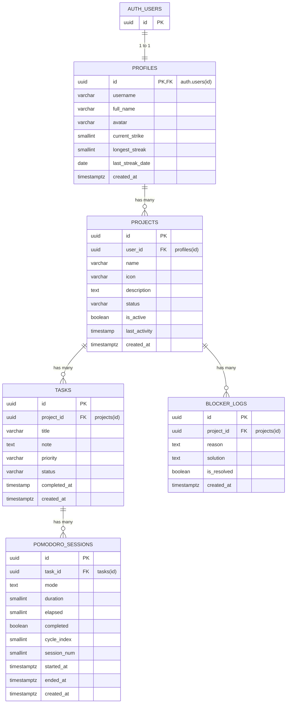

# Dokumentasi Struktur Database - StillBuilding

Dokumen ini berisi dokumentasi skema database PostgreSQL (Supabase) untuk aplikasi **StillBuilding**.

---

## 1. Diagram Relasi Entitas (ERD)



---

## 2. Rincian Tabel

### 2.1. `public.profiles`

Menyimpan informasi profil pengguna yang terhubung langsung dengan tabel autentikasi Supabase (`auth.users`).

| Kolom              | Tipe Data     | Nullable | Default             | Keterangan                                       |
| :----------------- | :------------ | :------: | :------------------ | :----------------------------------------------- |
| `id`               | `uuid`        |  **NO**  | `gen_random_uuid()` | **Primary Key**, Foreign Key ke `auth.users(id)` |
| `username`         | `varchar`     |   YES    | `NULL`              | Username unik pengguna                           |
| `full_name`        | `varchar`     |   YES    | `NULL`              | Nama lengkap pengguna                            |
| `avatar`           | `varchar`     |   YES    | `NULL`              | URL/Path avatar profil                           |
| `current_strike`   | `smallint`    |   YES    | `NULL`              | Jumlah streak kerja aktif saat ini               |
| `longest_streak`   | `smallint`    |   YES    | `NULL`              | Rekor streak terpanjang                          |
| `last_streak_date` | `date`        |   YES    | `NULL`              | Tanggal terakhir streak tercatat                 |
| `created_at`       | `timestamptz` |  **NO**  | `now()`             | Waktu profil dibuat                              |

---

### 2.2. `public.projects`

Menyimpan data proyek atau workspace kerja milik pengguna.

| Kolom           | Tipe Data     | Nullable | Default             | Keterangan                                               |
| :-------------- | :------------ | :------: | :------------------ | :------------------------------------------------------- |
| `id`            | `uuid`        |  **NO**  | `gen_random_uuid()` | **Primary Key**                                          |
| `user_id`       | `uuid`        |   YES    | `NULL`              | **Foreign Key** ke `public.profiles(id)`                 |
| `name`          | `varchar`     |   YES    | `NULL`              | Nama proyek                                              |
| `icon`          | `varchar`     |   YES    | `NULL`              | Ikon / emoji representasi proyek                         |
| `description`   | `text`        |   YES    | `NULL`              | Deskripsi proyek                                         |
| `status`        | `varchar`     |   YES    | `NULL`              | Status proyek (misal: `active`, `archived`, `completed`) |
| `is_active`     | `boolean`     |   YES    | `NULL`              | Flag penanda keaktifan proyek                            |
| `last_activity` | `timestamp`   |   YES    | `NULL`              | Waktu aktivitas terakhir pada proyek                     |
| `created_at`    | `timestamptz` |  **NO**  | `now()`             | Waktu pembuatan proyek                                   |

---

### 2.3. `public.tasks`

Menyimpan daftar tugas yang terkait dengan suatu proyek.

| Kolom          | Tipe Data     | Nullable | Default             | Keterangan                                                    |
| :------------- | :------------ | :------: | :------------------ | :------------------------------------------------------------ |
| `id`           | `uuid`        |  **NO**  | `gen_random_uuid()` | **Primary Key**                                               |
| `project_id`   | `uuid`        |   YES    | `NULL`              | **Foreign Key** ke `public.projects(id)`                      |
| `title`        | `varchar`     |   YES    | `NULL`              | Judul / nama tugas                                            |
| `note`         | `text`        |   YES    | `NULL`              | Catatan detail atau instruksi tugas                           |
| `priority`     | `varchar`     |   YES    | `NULL`              | Prioritas tugas (misal: `low`, `medium`, `high`, `urgent`)    |
| `status`       | `varchar`     |   YES    | `NULL`              | Status pengerjaan (misal: `todo`, `in_progress`, `completed`) |
| `completed_at` | `timestamp`   |   YES    | `NULL`              | Waktu penyelesaian tugas                                      |
| `created_at`   | `timestamptz` |  **NO**  | `now()`             | Waktu pembuatan tugas                                         |

---

### 2.4. `public.pomodoro_sessions`

Menyimpan riwayat dan sesi timer Pomodoro yang dikerjakan pada tugas tertentu.

| Kolom         | Tipe Data     | Nullable | Default             | Keterangan                                              |
| :------------ | :------------ | :------: | :------------------ | :------------------------------------------------------ |
| `id`          | `uuid`        |  **NO**  | `gen_random_uuid()` | **Primary Key**                                         |
| `task_id`     | `uuid`        |   YES    | `NULL`              | **Foreign Key** ke `public.tasks(id)`                   |
| `mode`        | `text`        |   YES    | `NULL`              | Mode sesi (misal: `focus`, `short_break`, `long_break`) |
| `duration`    | `smallint`    |   YES    | `NULL`              | Durasi target sesi (dalam menit/detik)                  |
| `elapsed`     | `smallint`    |   YES    | `NULL`              | Durasi yang telah terpakai/dijalankan                   |
| `completed`   | `boolean`     |   YES    | `NULL`              | Status apakah sesi selesai penuh                        |
| `cycle_index` | `smallint`    |   YES    | `NULL`              | Indeks siklus Pomodoro                                  |
| `session_num` | `smallint`    |   YES    | `NULL`              | Nomor urut sesi                                         |
| `started_at`  | `timestamptz` |   YES    | `NULL`              | Waktu sesi dimulai                                      |
| `ended_at`    | `timestamptz` |   YES    | `NULL`              | Waktu sesi berakhir                                     |
| `created_at`  | `timestamptz` |  **NO**  | `now()`             | Waktu pencatatan sesi dibuat                            |

---

### 2.5. `public.blocker_logs`

Mencatat kendala, hambatan, atau distraksi yang dialami selama mengerjakan proyek.

| Kolom         | Tipe Data     | Nullable | Default             | Keterangan                                      |
| :------------ | :------------ | :------: | :------------------ | :---------------------------------------------- |
| `id`          | `uuid`        |  **NO**  | `gen_random_uuid()` | **Primary Key**                                 |
| `project_id`  | `uuid`        |   YES    | `NULL`              | **Foreign Key** ke `public.projects(id)`        |
| `reason`      | `text`        |   YES    | `NULL`              | Alasan / penjelasan blocker atau hambatan       |
| `solution`    | `text`        |   YES    | `NULL`              | Catatan solusi saat kendala berhasil dipecahkan |
| `is_resolved` | `boolean`     |   YES    | `NULL`              | Status apakah kendala sudah terselesaikan       |
| `created_at`  | `timestamptz` |  **NO**  | `now()`             | Waktu blocker dicatat                           |

---

## 3. Ringkasan Relasi & Foreign Key

| Tabel Sumber               | Kolom FK     | Tabel Referensi   | Kolom Referensi | Hubungan  |
| :------------------------- | :----------- | :---------------- | :-------------- | :-------- |
| `public.profiles`          | `id`         | `auth.users`      | `id`            | 1-to-1    |
| `public.projects`          | `user_id`    | `public.profiles` | `id`            | Many-to-1 |
| `public.tasks`             | `project_id` | `public.projects` | `id`            | Many-to-1 |
| `public.pomodoro_sessions` | `task_id`    | `public.tasks`    | `id`            | Many-to-1 |
| `public.blocker_logs`      | `project_id` | `public.projects` | `id`            | Many-to-1 |

---

## 4. DDL Skema SQL

```sql
-- Profiles (User profile linked to Supabase Auth)
CREATE TABLE public.profiles (
  id uuid NOT NULL DEFAULT gen_random_uuid(),
  username character varying,
  full_name character varying,
  avatar character varying,
  current_strike smallint,
  longest_streak smallint,
  last_streak_date date,
  created_at timestamp with time zone NOT NULL DEFAULT now(),
  CONSTRAINT profiles_pkey PRIMARY KEY (id),
  CONSTRAINT profiles_id_fkey FOREIGN KEY (id) REFERENCES auth.users(id)
);

-- Projects
CREATE TABLE public.projects (
  id uuid NOT NULL DEFAULT gen_random_uuid(),
  user_id uuid,
  name character varying,
  icon character varying,
  description text,
  status character varying,
  is_active boolean,
  last_activity timestamp without time zone,
  created_at timestamp with time zone NOT NULL DEFAULT now(),
  CONSTRAINT projects_pkey PRIMARY KEY (id),
  CONSTRAINT projects_user_id_fkey FOREIGN KEY (user_id) REFERENCES public.profiles(id)
);

-- Tasks
CREATE TABLE public.tasks (
  id uuid NOT NULL DEFAULT gen_random_uuid(),
  project_id uuid,
  title character varying,
  note text,
  priority character varying,
  status character varying,
  completed_at timestamp without time zone,
  created_at timestamp with time zone NOT NULL DEFAULT now(),
  CONSTRAINT tasks_pkey PRIMARY KEY (id),
  CONSTRAINT tasks_project_id_fkey FOREIGN KEY (project_id) REFERENCES public.projects(id)
);

-- Pomodoro Sessions
CREATE TABLE public.pomodoro_sessions (
  id uuid NOT NULL DEFAULT gen_random_uuid(),
  task_id uuid,
  mode text,
  duration smallint,
  elapsed smallint,
  completed boolean,
  cycle_index smallint,
  session_num smallint,
  started_at timestamp with time zone,
  ended_at timestamp with time zone,
  created_at timestamp with time zone NOT NULL DEFAULT now(),
  CONSTRAINT pomodoro_sessions_pkey PRIMARY KEY (id),
  CONSTRAINT pomodoro_sessions_task_id_fkey FOREIGN KEY (task_id) REFERENCES public.tasks(id)
);

-- Blocker Logs
CREATE TABLE public.blocker_logs (
  id uuid NOT NULL DEFAULT gen_random_uuid(),
  project_id uuid,
  reason text,
  solution text,
  is_resolved boolean,
  created_at timestamp with time zone NOT NULL DEFAULT now(),
  CONSTRAINT blocker_logs_pkey PRIMARY KEY (id),
  CONSTRAINT blocker_logs_project_id_fkey FOREIGN KEY (project_id) REFERENCES public.projects(id)
);
```
