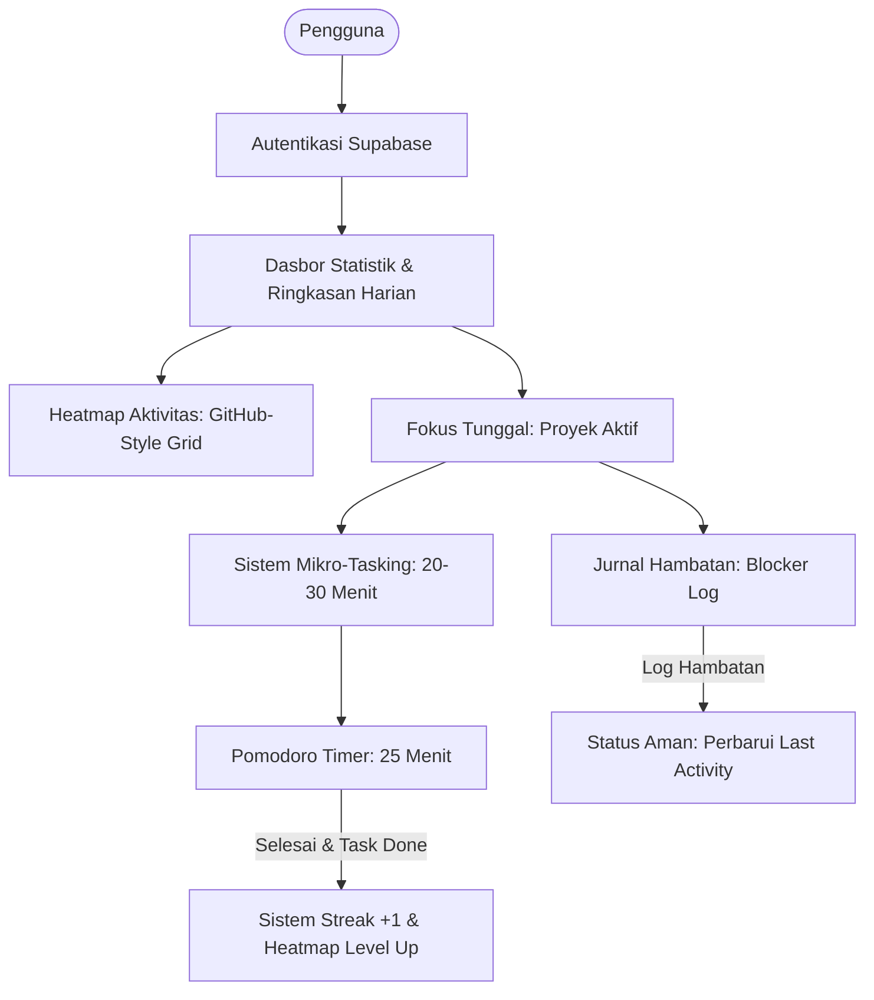

# Product Requirements Document (PRD) - StillBuilding

**Nama Produk:** StillBuilding  
**Versi:** 1.0 (Minimum Viable Product - MVP)  
**Status:** Approved / In Development  
**Target Platform:** Mobile App (React Native / Expo) & REST API Backend (Node.js / Express / Supabase)

---

## 1. Latar Belakang & Masalah (Problem Statement)

### 1.1. Latar Belakang

Banyak pengembang mandiri, pelajar teknologi, dan freelancer yang sering memulai proyek baru (baik untuk eksplorasi teknologi, proyek portofolio, maupun proyek klien) tetapi berakhir dengan meninggalkannya begitu saja (_abandoned projects_).

Penyebab utama kegagalan menyelesaikan proyek meliputi:

1. **Beban Mental & Overwhelm**: Tugas didefinisikan terlalu besar sehingga sulit untuk memulai (_procrastination by complexity_).
2. **Context Switching & Multitasking**: Mengerjakan terlalu banyak proyek sekaligus tanpa arah yang fokus.
3. **Roadblocks & Frustrasi**: Terjebak pada bug atau hambatan teknis tanpa ada sistem dokumentasi kendala, sehingga proyek ditinggalkan berlarut-larut.
4. **Hilangnya Momentum**: Ketiadaan pengingat visual atas progres bertahap yang telah dicapai.

### 1.2. Solusi: StillBuilding

**StillBuilding** adalah aplikasi manajemen proyek dan fokus kerja personal yang didesain dengan pendekatan psikologi rendah friksi (_low-friction productivity_). Melalui konsep **"Langkah Semut" (Mikro-Tasking)**, **Fokus Proyek Tunggal**, **Pelacak Hambatan (Blocker Log)**, **Dasbor Statistik Berbasis Data**, dan **Heatmap Aktivitas (GitHub-Style Contribution Graph)**, StillBuilding membantu pengguna mempertahankan momentum hingga proyek benar-benar selesai.

---

## 2. Prinsip Utama Produk (Core Principles)

1. **Rendah Hambatan Mental**: Tugas harus kecil (maksimal 20–30 menit) sehingga terasa mudah untuk langsung dieksekusi.
2. **Satu Fokus dalam Satu Waktu**: Hindari ilusi _multitasking_. Hanya ada 1 proyek yang aktif dalam satu sesi.
3. **Data-Driven & Bebas Distraksi**: Menghilangkan elemen gamifikasi kekanak-kanakan (avatar virtual/hewan peliharaan virtual), menggantikannya dengan dasbor metrik profesional dan visual ritme kerja yang elegan.
4. **Kejujuran Progres**: Pencatatan blocker diakui sebagai aktivitas valid pemeliharaan proyek, namun streak harian murni diperoleh dari aksi nyata (menyelesaikan tugas).

---

## 3. Fitur Utama & Spesifikasi Fungsional (MVP v1.0)

---

### 3.1. Fokus Tunggal (Single Active Project)

_Mencegah cognitive overload dengan membatasi perhatian pengguna pada 1 proyek aktif._

- **User Story:** Sebagai pengguna, saya ingin hanya ada 1 proyek aktif pada satu waktu agar saya tidak terdistraksi oleh proyek lain.
- **Aturan Bisnis:**
  - Pengguna dapat memiliki banyak proyek (status: `active`, `completed`, `archived`).
  - Flag `is_active = true` **hanya boleh dimiliki oleh maksimal 1 proyek**.
  - Jika pengguna mengaktifkan Proyek B, sistem secara otomatis menonaktifkan Proyek A (`is_active = false`).
- **Kriteria Penerimaan (Acceptance Criteria):**
  - Terdapat tombol toggle/pemicu "Jadikan Proyek Aktif".
  - Dasbor utama secara default menampilkan konteks dan tugas dari proyek yang sedang `is_active = true`.

---

### 3.2. Sistem Mikro-Tasking ("Langkah Semut")

_Membantu pengguna memecah proyek menjadi tugas-tugas terfokus tanpa beban estimasi yang kaku._

- **User Story:** Sebagai pengguna, saya ingin membuat tugas-tugas kecil yang terarah tanpa dipaksa menentukan estimasi waktu yang kaku di awal, karena durasi sebenarnya sering kali tidak pasti.
- **Aturan Bisnis:**
  - Tugas berfokus pada aksi konkret (_actionable unit of work_).
  - Tidak ada validasi batasan waktu yang memaksa/kaku pada input tugas. Pelacakan waktu riil dieksekusi secara dinamis melalui integrasi **Pomodoro Sessions**.
  - Setiap tugas terikat pada 1 `project_id`.
  - Atribut tugas: `title`, `note`, `priority` (`low`, `medium`, `high`, `urgent`), `status` (`Pending`, `Active`, `Done`), `completed_at`.
  - **Single Active Task:** Hanya boleh ada 1 tugas berstatus `Active` pada satu waktu. Mengaktifkan tugas baru otomatis mengembalikan tugas aktif sebelumnya ke `Pending`.
- **Kriteria Penerimaan:**
  - Pengguna dapat membuat, mengedit, mengubah status, dan menghapus tugas.
  - Saat tugas ditandai `Done`, sistem mencatat timestamp `completed_at` dan memicu evaluasi streak harian serta heatmap aktivitas.

---

### 3.3. Pomodoro Timer Terintegrasi

_Mendukung eksekusi fokus dengan interval standar 25 menit._

- **User Story:** Sebagai pengguna, saya ingin menjalankan sesi fokus 25 menit untuk tugas tertentu tanpa memperlambat perangkat atau server.
- **Aturan Bisnis:**
  - Durasi standar: **25 menit** (Deep Work), dengan opsi istirahat (**5 menit** _short break_ / **15 menit** _long break_) dalam siklus 4 sesi.
  - **Arsitektur Eksekusi:** Timer berjalan sepenuhnya di _frontend memory_ (menggunakan state Zustand di React Native) dengan sinkronisasi akurat saat aplikasi masuk ke background/foreground.
  - **Interaksi Selesai:** Ketika sesi Pomodoro selesai:
    1. Haptic feedback & alarm visual berbunyi.
    2. Muncul modal transisi interaktif: opsi _"Mulai Istirahat"_, _"Tandai Tugas Selesai & Ganti Tugas"_, atau lanjut sesi berikutnya.
    3. Payload dikirim ke endpoint backend `POST /pomodoro-sessions` untuk disimpan ke database Supabase.
  - **Auto-Pause on Distraction:** Menekan tombol pencatatan distraksi otomatis menjeda timer Pomodoro.
- **Kriteria Penerimaan:**
  - Timer dapat dimulai, dijeda (_pause_), direset, dan dilewati (_skip_).
  - Data sesi Pomodoro tersimpan dengan referensi `task_id` dan diagregasikan ke endpoint statistik harian (`GET /pomodoro-sessions/today-stats`).

---

### 3.4. Jurnal Hambatan (Blocker Log) & Status Aman

_Mendokumentasikan alasan spesifik mengapa proyek terhenti dan mencatat solusinya saat teratasi._

- **User Story:** Sebagai pengguna, saya ingin mencatat kendala saat stuck dan mencatat solusinya ketika berhasil dipecahkan agar menjadi referensi masa depan dan pengingat bahwa hambatan dapat diatasi.
- **Aturan Bisnis:**
  - Pengguna dapat membuat entri blocker dengan kolom `reason`, `solution`, dan `project_id`.
  - **"Status Aman"**: Menambahkan Blocker Log otomatis memperbarui `last_activity` pada proyek terkait.
  - **Penyelesaian Blocker**: Saat menandai `is_resolved = true`, pengguna dapat memasukkan catatan solusi (_how it was solved_). Ini kembali memperbarui `last_activity` proyek.
  - **Catatan Penting:** Pengisian Blocker Log **TIDAK** menambah poin streak harian (streak hanya bertambah dari penyelesaian tugas).
- **Kriteria Penerimaan:**
  - Modal pencatatan blocker cepat (`QuickBlockerModal`) saat sesi fokus.
  - Tab manajemen blocker riil di halaman detail proyek (tambah kendala, tandai tuntas dengan solusi, dan hapus).

---

### 3.5. Sistem Streak (Runtutan Hari Aktif) & Timezone

_Membangun kebiasaan konsisten setiap hari berbasis aksi nyata._

- **User Story:** Sebagai pengguna, saya ingin melihat jumlah hari berturut-turut saya produktif berdasarkan waktu lokal saya sendiri.
- **Aturan Bisnis:**
  - **Pemicu Streak:** Minimal **1 tugas** (`tasks`) diselesaikan (`status = Done`) pada hari kalender berjalan.
  - **Timezone Awareness:** Frontend mengirim timezone lokal perangkat (contoh: `Asia/Jakarta`) di request header/payload saat menyelesaikan tugas, sehingga pergantian hari dihitung tepat pada pukul 00:00 waktu lokal pengguna.
  - **Logika Perhitungan:**
    - Jika tugas diselesaikan pada hari berikutnya secara berurutan: `current_strike = current_strike + 1`.
    - Jika `current_strike > longest_streak`: update `longest_streak = current_strike`.
    - Jika terlewat > 1 hari kalender tanpa menyelesaikan tugas apa pun: `current_strike` direset menjadi 1 pada penyelesaian tugas berikutnya.
    - Jika menyelesaikan > 1 tugas di hari yang sama: `current_strike` tidak bertambah lagi untuk hari tersebut.
- **Kriteria Penerimaan:**
  - Angka streak tampil jelas di header/dasbor utama (`🔥 X Hari Streak`).
  - Logika kalkulasi streak divalidasi secara otomatis di backend pada kolom `current_strike`, `longest_streak`, dan `last_streak_date` di tabel `profiles`.

---

### 3.6. Dasbor Statistik Berbasis Data (Data-Driven Dashboard)

_Pusat informasi performa yang bersih, profesional, dan bebas elemen distraksi._

- **User Story:** Sebagai pengguna, saya ingin melihat ringkasan statistik performa kerja saya secara numerik dan terukur.
- **Komponen Metrik Utama:**
  1. **Daily Productivity Summary Cards**:
     - **Waktu Fokus**: Akumulasi durasi fokus hari ini (menit/jam) dari API sesi Pomodoro.
     - **Tugas Selesai**: Rasio tugas selesai vs total tugas aktif.
     - **Tugas Tersisa**: Jumlah tugas yang masih berstatus pending/aktif.
  2. **Quick Focus Banner**: Shortcut cepat ke tugas yang sedang aktif untuk langsung masuk ke timer Pomodoro.
- **Kriteria Penerimaan:**
  - Tampilan modern, bersih, dan mendukung pull-to-refresh (`RefreshControl`).

---

### 3.7. Heatmap Aktivitas & Ritme Kerja (GitHub-Style Contribution Graph)

_Visualisasi matriks konsistensi harian berbasis kotak hijau ala GitHub untuk memberikan kepuasan visual dan memacu momentum._

- **User Story:** Sebagai pengguna, saya ingin melihat grafik kontribusi berupa grid kotak-kotak hijau seperti di profil GitHub agar saya dapat mengevaluasi ritme dan konsistensi produktivitas saya selama beberapa bulan terakhir.
- **Aturan Bisnis:**
  - **Struktur Grid:**
    - 7 baris vertikal mewakili hari dalam seminggu (Senin s.d. Minggu).
    - Kolom horizontal mewakili rentang minggu (default: **12–16 minggu terakhir / 3 bulan terakhir**) dengan scroll horizontal yang mulus.
  - **Tingkat Intensitas Warna (Activity Level):**
    - ⬜ **Level 0 (Empty/Abu-abu)**: `0` aktivitas.
    - 🟩 **Level 1 (Hijau Muda `#86efac`)**: `1` aktivitas (1 task selesai atau 1 sesi fokus).
    - 🟩 **Level 2 (Hijau Sedang `#4ade80`)**: `2–3` aktivitas.
    - 🟩 **Level 3 (Hijau Solid `#22c55e`)**: `4–5` aktivitas.
    - 🟩 **Level 4 (Hijau Tua/Pekat `#15803d`)**: `6+` aktivitas (_High Productivity_).
  - **Interaktivitas:**
    - Menekan kotak tanggal tertentu memunculkan popover/tooltip informasi rincian aktivitas pada tanggal tersebut (contoh: _"29 Agustus 2026: 3 tugas selesai · 2 sesi fokus (50m)"_).
  - **Ringkasan Metrik:**
    - Menampilkan total kontribusi/aktivitas dalam periode yang dipilih dan hari paling produktif.
- **Kriteria Penerimaan:**
  - Grid tampil rapi, responsif di mobile, dan memiliki legenda level warna (Kurang ⬜ 🟩 🟩 🟩 🟩 Banyak).

---

### 3.8. Catatan Konteks (Notes Hierarchy)

_Menyimpan dokumentasi dan detail kontekstual._

- **Level Proyek (`projects.description` & docs):** Menyimpan _big picture_, tujuan akhir proyek, arsitektur, atau repositori link.
- **Level Tugas (`tasks.note`):** Menyimpan detail instruksi langkah semut, snippet kode kecil, tautan referensi spesifik, atau checklist kecil.

---

## 4. Matriks Aturan Bisnis & Validasi

| Fitur                  | Aksi Pengguna                | Dampak Database                                                   |                Dampak Streak?                 | Dampak Heatmap? |
| :--------------------- | :--------------------------- | :---------------------------------------------------------------- | :-------------------------------------------: | :-------------: |
| **Pilih Proyek Aktif** | Toggle aktifkan Proyek X     | Set Proyek X `is_active = true`, proyek lainnya `false`           |                   ❌ Tidak                    |    ❌ Tidak     |
| **Selesaikan Tugas**   | Checklist tugas selesai      | `status = 'Done'`, `completed_at = now()`                         |         ✅ **Ya (+1 jika hari baru)**         | ✅ **Ya (+1)**  |
| **Pomodoro Selesai**   | Timer 25m tuntas             | Insert ke `pomodoro_sessions`                                     | ❌ Tidak (Kecuali tugasnya dicentang selesai) | ✅ **Ya (+1)**  |
| **Catat Blocker**      | Submit log kendala baru      | Insert ke `blocker_logs`, update `projects.last_activity = now()` |                   ❌ Tidak                    |    ❌ Tidak     |
| **Selesaikan Blocker** | Tandai blocker terselesaikan | Update `blocker_logs.is_resolved = true`                          |                   ❌ Tidak                    |    ❌ Tidak     |

---

## 5. Kebutuhan Non-Fungsional (Non-Functional Requirements)

1. **Performa & Latensi**:
   - Respon API backend < 200ms untuk operasi CRUD standar.
   - Timer Pomodoro dan rendering Heatmap grid berjalan lancar di 60fps tanpa frame drop.
2. **Keamanan & Autentikasi**:
   - Semua request terlindungi menggunakan JWT Supabase melalui header `Authorization: Bearer <token>`.
   - Isolasi data pengguna: Pengguna hanya dapat membaca dan mengubah data miliknya sendiri (`user_id`).
3. **UI/UX & Estetika**:
   - Visual profesional, modern, dan minimalis.
   - Menggunakan NativeWind (Tailwind CSS) dengan palet warna bernuansa fokus (Slate, Emerald accents, Dark Mode first).
4. **Offline Capability (Fase Lanjut)**:
   - State timer lokal tetap berjalan meskipun koneksi internet terputus sementara.

---

## 6. Rencana Rilis & Versi

### Versi 1.0 (MVP Aktif)

- [x] Skema Database PostgreSQL (Supabase).
- [x] Manajemen Proyek (CRUD + Single Active Project logic).
- [x] Manajemen Tugas Mikro-Tasking (CRUD + Priority + Single Active Task).
- [x] Pomodoro Timer 25 Menit (Client-side state + Session logger + Auto-pause distraction).
- [x] Jurnal Blocker (CRUD + Resolve status & solution note).
- [x] Dasbor Ringkasan Produktivitas Harian (`DailySummaryCards`).
- [x] Sistem Streak Harian Otomatis (`🔥` Streak Badge & Timezone-aware Calculation).
- [x] Heatmap Aktivitas & Ritme Produktivitas (GitHub-Style Contribution Graph).

### Versi 1.1 (Deep Work & Ambient Audio Experience)

- [x] **Background Audio & Playback Session**: Pemutaran looping ambient focus audio offline (Hujan Lembut, White Noise, Kafe Tenang, Ombak Laut) menggunakan `expo-audio` dengan izin background audio di Android & iOS.
- [x] **Notifikasi Lokal Otomatis di Background**: Penjadwalan notifikasi penyelesaian sesi tepat waktu menggunakan `expo-notifications` saat layar HP mati/terkunci, dengan deep navigation langsung ke modal transisi fokus.
- [x] **Modal Pemilih Suara & Kontrol Volume**: Antarmuka Bottom Sheet minimalis (`AmbientSoundModal`) untuk pemilihan sound track dan volume slider terintegrasi dengan Pomodoro.
- [x] **Chime Bell Akhir Sesi**: Suara lonceng lembut (432Hz harmonic bell) otomatis saat sesi fokus 25 menit tuntas.
- [x] **Transisi Fase Istirahat Otomatis**: Audio ambient otomatis hening saat jeda istirahat (_break_) dimulai untuk memberikan ruang istirahat yang tenang.

### Versi 1.2 (Deep Flow & Momentum Booster)

- [ ] **Quick Brain Dump / Distraction Catcher**: Modal tangkapan cepat 1-tap di antarmuka Pomodoro untuk mencatat pikiran atau distraksi internal yang mendadak muncul (3 detik) ke dalam _Quick Inbox_ tanpa memecah ritme fokus atau menghentikan timer.
- [ ] **Preset Durasi Fokus Fleksibel**: Opsi preset durasi kerja tanpa konfigurasi rumit: _Quick Sprint_ (15 menit untuk mengatasi rasa malas mulai), _Classic Pomodoro_ (25 menit), dan _Deep Flow / Ultradian_ (50 menit untuk sesi koding mendalam).
- [ ] **Zen Desk Mode & Keep-Awake**: Tampilan layar penuh minimalis saat ponsel diletakkan di samping keyboard meja kerja, terintegrasi dengan `expo-keep-awake` agar layar tidak mati otomatis selama sesi Pomodoro aktif.
- [ ] **Export Standup & Log Progres Markdown**: Tombol 1-klik untuk menyalin ringkasan tugas selesai dan kendala terpecahkan (_blockers resolved_) hari ini ke clipboard dalam format teks/Markdown bersih, siap ditempel ke laporan tim, standup harian, atau log portofolio.
- [ ] **Morning Kickoff & Evening Shutdown Ritual**: Layar pembuka harian singkat (30 detik) saat pertama kali membuka aplikasi untuk memilih 1 tugas prioritas hari ini (_intention setting_), serta prompt penutupan opsional di malam hari untuk mencatat pencapaian dan menyiapkan langkah pertama esok hari (_Resume Anchor / Hemingway Bridge_).
- [ ] **Focus Shield / Do Not Disturb Sync**: Integrasi otomatis dengan mode _Do Not Disturb_ sistem operasi ponsel — DND aktif saat Pomodoro dimulai dan nonaktif saat sesi berakhir atau istirahat, dengan peringatan lembut jika pengguna meninggalkan aplikasi saat timer berjalan (_"Timer masih berjalan. Kembali fokus?"_).

### Versi 1.3 (Habit Continuity & Advanced Insights)

- [ ] **Streak Freeze & Grace Day**: Kuota perlindungan streak berkala (1–2 kali per bulan / opsi _Weekend Rest Mode_) agar momentum tidak runtuh akibat kondisi darurat, sakit, atau hari libur mendadak (_mencegah What-the-Hell effect_).
- [ ] **Target Harian Realistis (_Daily Closure_)**: Target mikro harian opsional (misal: 3 tugas selesai atau 4 sesi fokus) dengan umpan balik visual kepuasan saat tercapai untuk memberikan rasa tuntas dan mencegah _burnout_.
- [ ] **Weekly Retrospective / Review**: Halaman rekap mingguan otomatis berbasis data Supabase (total jam fokus, mikro-task tuntas, kendala terpecahkan, serta pola hari/jam paling produktif).
- [ ] **Lock Screen Ongoing Timer & Live Activity**: Menampilkan sisa waktu sesi fokus langsung di layar kunci ponsel (Android Ongoing Notification / iOS Live Activity) sehingga pengguna dapat memantau waktu tanpa membuka kunci HP yang memicu distraksi.
- [ ] **Task Tagging & Activity Breakdown Chart**: Tag kategori opsional 1-tap pada tugas atau sesi Pomodoro (`Coding`, `Debugging`, `Design/UI`, `Research`, `DevOps`, atau tag kustom) dengan visualisasi donut chart distribusi waktu kerja di dasbor mingguan untuk memberikan kesadaran ke mana energi kerja sebenarnya tercurah.
- [ ] **Recurring Micro-Tasks (Tugas Berulang)**: Opsi pengulangan otomatis pada tugas rutin (_Harian / Senin–Jumat / Mingguan / Kustom_) sehingga kebiasaan teknis seperti _"Review PR pagi"_, _"Tulis test sebelum merge"_, atau _"Backup database tiap Jumat"_ muncul kembali di daftar tugas tanpa harus dibuat ulang secara manual.
- [ ] **Project Health Indicator (Lampu Proyek)**: Indikator visual otomatis di daftar proyek berdasarkan data aktivitas terakhir — 🟢 _Sehat_ (aktivitas dalam 24 jam), 🟡 _Melambat_ (tidak ada aktivitas 2–4 hari), 🔴 _Kritis_ (≥5 hari tanpa aktivitas) — sebagai sinyal peringatan dini tanpa notifikasi agresif.

### Versi 1.4 (Project Closure & Developer Experience)

- [ ] **"Ship It!" Hall of Fame & Retrospective Card (Ala Strava)**: Kartu pencapaian visual saat status proyek diubah menjadi `Completed`, merangkum bukti kerja (_proof of work_): total jam fokus, akumulasi sesi Pomodoro, mikro-task tuntas, dan blocker yang berhasil ditaklukkan. Dilengkapi fitur 1-klik bagikan kartu ke media sosial/komunitas (_Build in Public_) serta tab galeri _Hall of Fame_ sebagai trofi proyek yang sukses dituntaskan.
- [ ] **Home Screen Heatmap Widget**: Widget ringkas di layar utama ponsel (iOS & Android) yang menampilkan grid kontribusi kotak-kotak hijau dan status proyek aktif, memberikan pengingat visual instan untuk menjaga ritme momentum kerja tanpa perlu membuka aplikasi terlebih dahulu.
- [ ] **IDE Theme Palettes (Tema Khas Editor Kode)**: Kustomisasi palet warna aplikasi yang terinspirasi dari skema warna editor kode populer developer (_Catppuccin Mocha_, _Nord Minimal_, _Tokyo Night_, dan _Gruvbox Dark_) untuk memberikan kepuasan estetika personal yang menyatu dengan lingkungan koding harian.
- [ ] **Estimasi vs Realita — Calibration Tracker**: Kolom estimasi opsional saat membuat tugas (_"Perkiraan: 2 sesi Pomodoro"_) yang dibandingkan otomatis dengan durasi aktual saat tugas selesai, menghasilkan metrik kalibrasi bulanan (_"Akurasi estimasi: 65% · Rata-rata underestimate 1.8×"_) untuk melatih kemampuan perencanaan scope kerja secara bertahap.
- [ ] **Milestone & Checkpoint System (Penanda Fase Proyek)**: Pembagian proyek besar menjadi beberapa fase/milestone (misal: _"Fase 1: Setup & Slicing"_, _"Fase 2: API Integration"_, _"Fase 3: Deploy"_) dengan kumpulan micro-task masing-masing, disertai mini-celebration visual (animasi confetti ringan + ringkasan pencapaian) saat setiap milestone tuntas untuk memberikan rasa progres bertahap.

### Versi 1.5 (Resilience & Infrastructure)

- [ ] **Offline-First & Background Sync**: Penyimpanan data tugas, sesi Pomodoro, dan blocker log secara lokal terlebih dahulu (SQLite / MMKV) dengan sinkronisasi otomatis ke Supabase saat koneksi internet tersedia kembali, memastikan pengalaman kerja yang tidak terganggu oleh kondisi jaringan — _"always works, syncs when it can"_.

---

## 7. Kebijakan Versioning, Rilis, & Backward Compatibility

_Memastikan kesinambungan pengalaman pengguna di aplikasi mobile tanpa terganggu oleh pembaruan sistem._

### 7.1. Dua Lapisan Versi (Two-Tier Versioning)

1. **Public Semantic Versioning (`MAJOR.MINOR.PATCH`)**:
   - Dikonfigurasi di `apps/mobile/app.json` (`"version"`).
   - **PATCH (`x.x.+1`)**: Perbaikan bug, pembenahan styling, dan hotfix tanpa penambahan fitur baru.
   - **MINOR (`x.+1.0`)**: Penambahan fitur baru yang terlihat pengguna dan kompatibel ke belakang.
   - **MAJOR (`+1.0.0`)**: Perombakan arsitektur besar, redesign menyeluruh, atau perubahan data/akun inti.
   - Ditampilkan secara dinamis di UI pada halaman Profil > Tentang Aplikasi via `Constants.expoConfig?.version`.
2. **Binary Build Identifier (`versionCode` & `buildNumber`)**:
   - Dikelola secara otomatis oleh EAS Build via konfigurasi `"appVersionSource": "remote"` dan `"autoIncrement": true` di `apps/mobile/eas.json`.
   - Menjamin nomor build unik yang strictly-increasing untuk Google Play Console dan App Store Connect pada setiap rilis produksi.

### 7.2. Prinsip Kompatibilitas Backend (Backward-Compatibility First)

- **Menghindari Force-Update Agresif**: Pengguna mobile tidak dipaksa memperbarui aplikasi seketika. Sistem backend dirancang untuk tetap melayani klien versi lawas.
- **Perubahan Bersifat Aditif (Additive-Only Changes)**: Penambahan fitur di respons JSON backend tidak boleh menghapus atau mengubah tipe properti yang sudah ada.
- **Nilai Default Skema Input (Zod)**: Semua kolom/properti baru pada endpoint mutasi (`POST`/`PUT`) di `packages/types` wajib bersifat opsional atau memiliki nilai default.
- **Client Identity Tracking**: Aplikasi mobile mengirimkan header `x-app-version` dan `x-platform` pada setiap panggilan API via Axios interceptor, memungkinkan audit log dan analisis distribusi versi klien yang masih aktif di lapangan.
- **Panduan Teknis Lengkap**: Rincian alur rilis, checklist rilis, dan contoh implementasi terdokumentasi di [`apps/mobile/VERSIONING.md`](./apps/mobile/VERSIONING.md).
