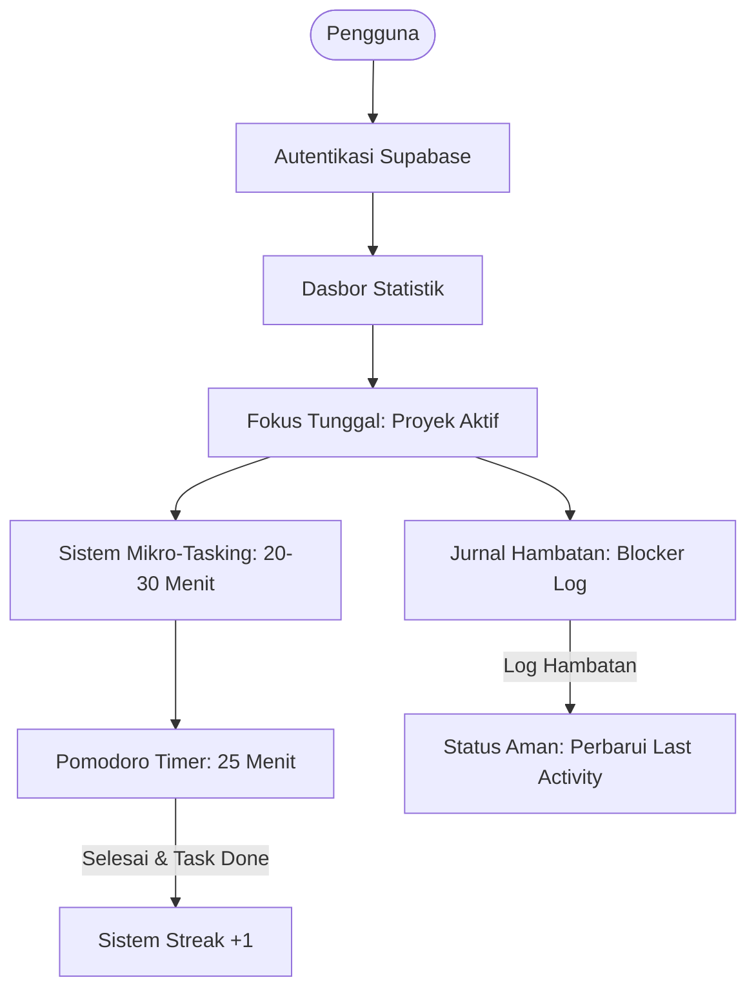

# Product Requirements Document (PRD) - StillBuilding

**Nama Produk:** StillBuilding  
**Versi:** 1.0 (Minimum Viable Product - MVP)  
**Status:** Approved / In Development  
**Target Platform:** Mobile App (React Native / Expo) & REST API Backend (Node.js / Express / Supabase)

---

## 1. Latar Belakang & Masalah (Problem Statement)

### 1.1. Latar Belakang

Banyak pengembang mandiri, pelajar teknologi, dan freelancer yang sering memulai proyek baru (baik untuk eksplorasi teknologi, proyek portofolio, maupun proyek klien) tetapi berakhir dengan meninggalkannya begitu saja (_abandoned projects_).

Penyebab utama kegagalan menyelesaikan proyek meliputi:

1. **Beban Mental & Overwhelm**: Tugas didefinisikan terlalu besar sehingga sulit untuk memulai (_procrastination by complexity_).
2. **Context Switching & Multitasking**: Mengerjakan terlalu banyak proyek sekaligus tanpa arah yang fokus.
3. **Roadblocks & Frustrasi**: Terjebak pada bug atau hambatan teknis tanpa ada sistem dokumentasi kendala, sehingga proyek ditinggalkan berlarut-larut.
4. **Hilangnya Momentum**: Ketiadaan pengingat visual atas progres bertahap yang telah dicapai.

### 1.2. Solusi: StillBuilding

**StillBuilding** adalah aplikasi manajemen proyek dan fokus kerja personal yang didesain dengan pendekatan psikologi rendah friksi (_low-friction productivity_). Melalui konsep **"Langkah Semut" (Mikro-Tasking)**, **Fokus Proyek Tunggal**, **Pelacak Hambatan (Blocker Log)**, dan **Dasbor Statistik Berbasis Data**, StillBuilding membantu pengguna mempertahankan momentum hingga proyek benar-benar selesai.

---

## 2. Prinsip Utama Produk (Core Principles)

1. **Rendah Hambatan Mental**: Tugas harus kecil (maksimal 20–30 menit) sehingga terasa mudah untuk langsung dieksekusi.
2. **Satu Fokus dalam Satu Waktu**: Hindari ilusi _multitasking_. Hanya ada 1 proyek yang aktif dalam satu sesi.
3. **Data-Driven & Bebas Distraksi**: Menghilangkan elemen gamifikasi kekanak-kanakan (avatar virtual/hewan peliharaan virtual), menggantikannya dengan dasbor metrik profesional dan elegan.
4. **Kejujuran Progres**: Pencatatan blocker diakui sebagai aktivitas valid pemeliharaan proyek, namun streak harian murni diperoleh dari aksi nyata (menyelesaikan tugas).

---

## 3. Fitur Utama & Spesifikasi Fungsional (MVP v1.0)

---

### 3.1. Fokus Tunggal (Single Active Project)

_Mencegah cognitive overload dengan membatasi perhatian pengguna pada 1 proyek aktif._

- **User Story:** Sebagai pengguna, saya ingin hanya ada 1 proyek aktif pada satu waktu agar saya tidak terdistraksi oleh proyek lain.
- **Aturan Bisnis:**
  - Pengguna dapat memiliki banyak proyek (status: `active`, `completed`, `archived`).
  - Flag `is_active = true` **hanya boleh dimiliki oleh maksimal 1 proyek**.
  - Jika pengguna mengaktifkan Proyek B, sistem secara otomatis menonaktifkan Proyek A (`is_active = false`).
- **Kriteria Penerimaan (Acceptance Criteria):**
  - Terdapat tombol toggle/pemicu "Jadikan Proyek Aktif".
  - Dasbor utama secara default menampilkan konteks dan tugas dari proyek yang sedang `is_active = true`.

---

### 3.2. Sistem Mikro-Tasking ("Langkah Semut")

_Membantu pengguna memecah proyek menjadi tugas-tugas terfokus tanpa beban estimasi yang kaku._

- **User Story:** Sebagai pengguna, saya ingin membuat tugas-tugas kecil yang terarah tanpa dipaksa menentukan estimasi waktu yang kaku di awal, karena durasi sebenarnya sering kali tidak pasti.
- **Aturan Bisnis:**
  - Tugas berfokus pada aksi konkret (_actionable unit of work_).
  - Tidak ada validasi batasan waktu yang memaksa/kaku pada input tugas. Pelacakan waktu riil dieksekusi secara dinamis melalui integrasi **Pomodoro Sessions**.
  - Setiap tugas terikat pada 1 `project_id`.
  - Atribut tugas: `title`, `note`, `priority` (`low`, `medium`, `high`, `urgent`), `status` (`todo`, `in_progress`, `completed`), `completed_at`.
- **Kriteria Penerimaan:**
  - Pengguna dapat membuat, mengedit, mengubah status, dan menghapus tugas.
  - Saat tugas ditandai `completed`, sistem mencatat timestamp `completed_at` dan memicu evaluasi streak harian.

---

### 3.3. Pomodoro Timer Terintegrasi

_Mendukung eksekusi fokus dengan interval standar 25 menit._

- **User Story:** Sebagai pengguna, saya ingin menjalankan sesi fokus 25 menit untuk tugas tertentu tanpa memperlambat perangkat atau server.
- **Aturan Bisnis:**
  - Durasi standar: **25 menit** (fokus), dengan opsi istirahat (_short break_ 5 menit / _long break_ 15 menit).
  - **Arsitektur Eksekusi:** Timer berjalan sepenuhnya di _frontend memory_ (menggunakan state lokal/Zustand di React Native) agar ringan dan tidak membebani server/kuota request.
  - **Interaksi Selesai:** Ketika sesi Pomodoro (25 menit) selesai:
    1. Alarm/notifikasi berbunyi.
    2. Muncul prompt/modal interaktif: _"Sesi fokus selesai! Apakah tugas ini sudah rampung?"_ dengan aksi cepat _"Tandai Selesai"_ atau _"Lanjut Istirahat / Sesi Berikutnya"_.
    3. Frontend mengirim payload ke endpoint backend `POST /pomodoro-sessions` untuk disimpan ke database.
- **Kriteria Penerimaan:**
  - Timer dapat dimulai, dijeda (_pause_), dan direset.
  - Data sesi Pomodoro tersimpan dengan referensi `task_id`.

---

### 3.4. Jurnal Hambatan (Blocker Log) & Status Aman

_Mendokumentasikan alasan spesifik mengapa proyek terhenti dan mencatat solusinya saat teratasi._

- **User Story:** Sebagai pengguna, saya ingin mencatat kendala saat stuck dan mencatat solusinya ketika berhasil dipecahkan agar menjadi referensi masa depan dan pengingat bahwa hambatan dapat diatasi.
- **Aturan Bisnis:**
  - Pengguna dapat membuat entri blocker dengan kolom `reason` dan `project_id`.
  - **"Status Aman"**: Menambahkan Blocker Log otomatis memperbarui `last_activity` pada proyek terkait.
  - **Penyelesaian Blocker**: Saat menandai `is_resolved = true`, pengguna dapat memasukkan catatan solusi (_how it was solved_). Ini kembali memperbarui `last_activity` proyek.
  - **Deteksi Proyek Terabaikan (_Neglect Alert_)**:
    - **Aman (0–3 hari)**: Aktivitas normal (ada task selesai / blocker dicatat).
    - **Perlu Perhatian (3–7 hari tanpa aktivitas)**: Proyek diberi label/highlight visual kuning/merah _"Perlu Perhatian / Berisiko Terbengkalai"_ di dasbor untuk memicu aksi pengguna.
  - **Catatan Penting:** Pengisian Blocker Log **TIDAK** menambah poin streak harian (streak hanya bertambah dari penyelesaian tugas).
- **Kriteria Penerimaan:**
  - Form pencatatan blocker cepat dan modal penyelesaian blocker dengan input solusi.
  - Indikator visual status keaktifan proyek berdasarkan selisih hari dari `last_activity`.

---

### 3.5. Sistem Streak (Runtutan Hari Aktif) & Timezone

_Membangun kebiasaan konsisten setiap hari berbasis aksi nyata._

- **User Story:** Sebagai pengguna, saya ingin melihat jumlah hari berturut-turut saya produktif berdasarkan waktu lokal saya sendiri.
- **Aturan Bisnis:**
  - **Pemicu Streak:** Minimal **1 tugas** (`tasks`) diselesaikan (`status = completed`) pada hari kalender berjalan.
  - **Timezone Awareness:** Frontend mengirim timezone lokal perangkat (contoh: `Asia/Jakarta`) di request header/payload saat menyelesaikan tugas, sehingga pergantian hari dihitung tepat pada pukul 00:00 waktu lokal pengguna.
  - **Logika Perhitungan:**
    - Jika tugas diselesaikan pada hari berikutnya secara berurutan: `current_strike = current_strike + 1`.
    - Jika `current_strike > longest_streak`: update `longest_streak = current_strike`.
    - Jika terlewat > 1 hari kalender tanpa menyelesaikan tugas apa pun: `current_strike` direset menjadi 1 pada penyelesaian tugas berikutnya.
    - Jika menyelesaikan > 1 tugas di hari yang sama: `current_strike` tidak bertambah lagi untuk hari tersebut.
- **Kriteria Penerimaan:**
  - Angka streak tampil jelas di header/dasbor utama.
  - Logika kalkulasi streak divalidasi secara konsisten di backend dengan menghitung hari kalender berbasis timezone pengguna.

---

### 3.6. Dasbor Statistik Berbasis Data (Data-Driven Dashboard)

_Pusat informasi performa yang bersih, profesional, dan bebas elemen distraksi._

- **User Story:** Sebagai pengguna, saya ingin melihat ringkasan statistik performa kerja saya secara numerik dan terukur.
- **Komponen Metrik Utama:**
  1. **Active Streak & Record**: Menampilkan `current_strike` aktif dan rekor `longest_streak`.
  2. **Tasks Completed**: Rasio tugas selesai hari ini serta total tugas selesai vs total tugas keseluruhan proyek.
  3. **Pomodoro Focus & Total Time**: Akumulasi jumlah sesi Pomodoro yang selesai dan total waktu fokus (dalam jam/menit).
  4. **Blockers Resolved**: Jumlah total blocker yang berhasil diselesaikan (`is_resolved = true`) sebagai bukti empiris pemecahan masalah teknis.
- **Kriteria Penerimaan:**
  - Desain antarmuka modern (Dark/Light mode elegan, typography bersih).
  - Bebas dari avatar virtual kartun atau fitur non-esensial yang memicu distraksi.

---

### 3.7. Catatan Konteks (Notes Hierarchy)

_Menyimpan dokumentasi dan detail kontekstual._

- **Level Proyek (`projects.description` & docs):** Menyimpan _big picture_, tujuan akhir proyek, arsitektur, atau repositori link.
- **Level Tugas (`tasks.note`):** Menyimpan detail instruksi langkah semut, snippet kode kecil, tautan referensi spesifik, atau checklist kecil.

---

## 4. Matriks Aturan Bisnis & Validasi

| Fitur                  | Aksi Pengguna                | Dampak Database                                                   |                Dampak Streak?                 |
| :--------------------- | :--------------------------- | :---------------------------------------------------------------- | :-------------------------------------------: |
| **Pilih Proyek Aktif** | Toggle aktifkan Proyek X     | Set Proyek X `is_active = true`, proyek lainnya `false`           |                   ❌ Tidak                    |
| **Selesaikan Tugas**   | Checklist tugas selesai      | `status = 'completed'`, `completed_at = now()`                    |         ✅ **Ya (+1 jika hari baru)**         |
| **Pomodoro Selesai**   | Timer 25m tuntas             | Insert ke `pomodoro_sessions`                                     | ❌ Tidak (Kecuali tugasnya dicentang selesai) |
| **Catat Blocker**      | Submit log kendala baru      | Insert ke `blocker_logs`, update `projects.last_activity = now()` |                   ❌ Tidak                    |
| **Selesaikan Blocker** | Tandai blocker terselesaikan | Update `blocker_logs.is_resolved = true`                          |                   ❌ Tidak                    |

---

## 5. Kebutuhan Non-Fungsional (Non-Functional Requirements)

1. **Performa & Latensi**:
   - Respon API backend < 200ms untuk operasi CRUD standar.
   - Timer Pomodoro berjalan secara lokal tanpa lag atau _frame drop_.
2. **Keamanan & Autentikasi**:
   - Semua request terlindungi menggunakan JWT Supabase melalui header `Authorization: Bearer <token>`.
   - Isolasi data pengguna: Pengguna hanya dapat membaca dan mengubah data miliknya sendiri (`user_id`).
3. **UI/UX & Estetika**:
   - Visual profesional, modern, dan minimalis.
   - Menggunakan NativeWind (Tailwind CSS) dengan palet warna bernuansa fokus (Slate, Indigo/Emerald accents, Dark Mode first).
4. **Offline Capability (Fase Lanjut)**:
   - State timer lokal tetap berjalan meskipun koneksi internet terputus sementara.

---

## 6. Rencana Rilis & Versi

### Versi 1.0 (MVP Aktif)

- [x] Skema Database PostgreSQL (Supabase).
- [ ] Manajemen Proyek (CRUD + Single Active Project logic).
- [ ] Manajemen Tugas Mikro-Tasking (CRUD + Priority).
- [ ] Pomodoro Timer 25 Menit (Client-side state + Session logger).
- [ ] Jurnal Blocker (CRUD + Resolve status).
- [ ] Sistem Streak Harian.
- [ ] Dasbor Statistik Utama.

### Versi 1.1 (Next Iteration)

- Integrasi Git Commit Hook (opsional untuk auto-complete micro-task).
- Audio ambient focus (White noise / Rain sound) saat Pomodoro aktif.
- Export catatan proyek ke Markdown.
