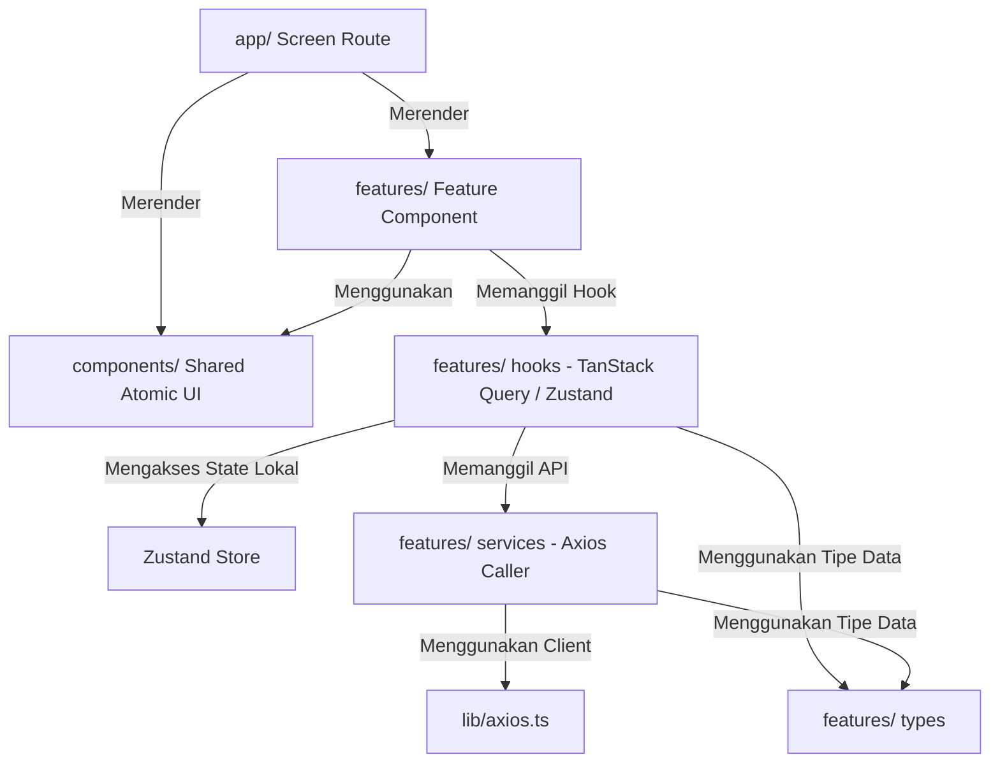

# Panduan Arsitektur Frontend (*Frontend Architecture*)

Dokumen ini menjelaskan struktur direktori, prinsip pemisahan tanggung jawab (*Separation of Concerns*), dan pola pengembangan aplikasi Kerjain Frontend agar kode tetap modular, terisolasi dengan baik, dan mudah diperluas (*scalable*).

---

## 1. Prinsip Utama Arsitektur (*Core Architectural Principles*)

1. **Feature-Driven Structure**: Logika domain (seperti `task`, `project`, `pomodoro`) dikelompokkan dalam direktori `features/`. Setiap fitur memiliki komponen internal, hooks, servis API, dan deklarasi tipe datanya sendiri.
2. **Thin Route Screens**: File-file di dalam direktori `app/` (Expo Router) hanya berfungsi sebagai *entry point* / perutean (*routing wrapper*). Layar tidak boleh memuat logika bisnis yang kompleks ataupun query API langsung.
3. **Decoupled Business & API Logic**: Logika interaksi API diisolasi ke dalam `services/`, dibungkus oleh custom React Query hooks di `hooks/`, sehingga komponen UI murni fokus pada presentasi dan interaksi pengguna.
4. **Shared Atomic Components**: Komponen yang bersifat umum (seperti tombol, form field input, card, badge, modal) diletakkan di `components/` dan tidak boleh memiliki dependensi pada logika spesifik domain tertentu.
5. **Strict TypeScript Typing**: Seluruh entity model, request payload, dan response payload didefinisikan secara eksplisit di dalam `types/`. Penggunaan tipe `any` dilarang.

---

## 2. Struktur Direktori (*Directory Structure*)

```
frontend/
├── app/                              # Layer Navigasi & Halaman (Expo Router)
│   ├── (auth)/                       # Rute khusus user belum login
│   │   ├── _layout.tsx
│   │   ├── login.tsx
│   │   └── register.tsx
│   ├── (tabs)/                       # Navigasi Tab Bar utama
│   │   ├── _layout.tsx
│   │   ├── home.tsx
│   │   ├── projects.tsx
│   │   └── profile.tsx
│   ├── pomodoro/                     # Screen rute fitur Pomodoro
│   │   ├── _layout.tsx
│   │   └── index.tsx
│   ├── project/                      # Screen rute fitur Project (CRUD)
│   │   ├── [id].tsx
│   │   ├── create.tsx
│   │   └── edit.tsx
│   ├── task/                         # Screen rute fitur Task (CRUD)
│   │   ├── [id].tsx
│   │   ├── create.tsx
│   │   └── edit.tsx
│   └── _layout.tsx                   # Root provider layout (React Query, Auth, Toast)
│
├── features/                         # Layer Domain Bisnis (Feature-Driven Modules)
│   ├── pomodoro/
│   │   ├── components/               # Komponen spesifik Pomodoro (TimerDisplay, BlockerModal, dll)
│   │   ├── hooks/                    # Hook TanStack Query & Timer State
│   │   ├── services/                 # Panggilan API Pomodoro (Axios)
│   │   └── types/                    # Tipe data Pomodoro & Blocker
│   ├── project/
│   │   ├── components/               # Komponen spesifik Project (ProjectCard, ProjectFilter, dll)
│   │   ├── hooks/                    # Hook TanStack Query (useProjects, useProjectDetail, useCreateProject)
│   │   ├── services/                 # Panggilan API Project (Axios)
│   │   └── types/                    # Tipe data Project
│   └── task/
│       ├── components/               # Komponen spesifik Task (TaskItem, TaskForm, PriorityPicker, dll)
│       ├── hooks/                    # Hook TanStack Query (useTasks, useTaskDetail, useMutateTask)
│       ├── services/                 # Panggilan API Task (Axios)
│       └── types/                    # Tipe data Task & TaskStatus
│
├── components/                       # Layer UI Reusable / Atomic Components
│   ├── Button.tsx                    # Tombol dengan varian primary, secondary, outline, loading
│   ├── FormField.tsx                 # Wrapper input form dengan label, error message, & helper text
│   ├── FieldInput.tsx                # Base input component
│   └── ...                           # Komponen reusable lainnya (Badge, Modal, BottomSheet)
│
├── lib/                              # Konfigurasi Pihak Ketiga & Client Singletons
│   ├── axios.ts                      # Instance Axios + Interceptor auth & error
│   └── reactQuery.ts                 # QueryClient singleton & tipe helper Query/Mutation
│
├── utils/                            # Helper Functions & Pure Utilities
│   ├── date.ts                       # Format tanggal dan interval waktu
│   ├── duration.ts                   # Konversi detik ke format mm:ss / jam
│   └── validation.ts                 # Helper validasi skema umum
│
├── assets/                           # Asset statis gambar, icon, splash screen
├── global.css                        # Desain token tema, warna, dan layer Tailwind CSS
├── tsconfig.json                     # Konfigurasi TypeScript & path aliases
└── package.json                      # Daftar dependensi & npm scripts
```

---

## 3. Pembagian Tanggung Jawab Modul (*Layer Responsibilities*)



### 1. Layer `app/` (Screens & Navigation)
- **Tanggung Jawab**: Mendefinisikan rute dan parameter layar menggunakan Expo Router.
- **Batasan**:
  - Hanya merender layout dan komponen fitur.
  - Mengambil parameter URL (contoh: `const { id } = useLocalSearchParams()`).
  - **TIDAK BOLEH** menuliskan query database/API langsung atau logika kalkulasi yang rumit.

### 2. Layer `features/<feature>/` (Domain Logic)
- **`types/`**: Mendefinisikan schema TypeScript untuk model data, payload input, dan response API.
- **`services/`**: Berisi fungsi asinkron murni yang memanggil endpoint API menggunakan instance `lib/axios.ts`.
- **`hooks/`**: Membungkus pemanggilan service ke dalam TanStack Query (`useQuery`, `useMutation`) dengan manajemen cache yang tepat.
- **`components/`**: Komponen visual yang hanya relevan dengan fitur tersebut (contoh: `TaskPriorityBadge`, `PomodoroClockFace`).

### 3. Layer `components/` (Shared Atomic UI)
- **Tanggung Jawab**: Komponen UI independen (*pure presentation*) yang dapat digunakan di fitur manapun.
- **Karakteristik**:
  - Diberi styling menggunakan utility class NativeWind.
  - Memiliki varian prop (misal: `variant="primary" | "secondary" | "danger"`, `size="sm" | "md" | "lg"`).
  - Tidak terikat pada state domain spesifik.

### 4. Layer `lib/` (Infrastructure Setup)
- **Tanggung Jawab**: Instansiasi client library seperti Axios dan React Query.
- **Aturan**: Interceptor request menyisipkan bearer token Supabase Auth, dan interceptor response menangani error HTTP global (401, 403, 500).

---

## 4. Panduan Menambahkan Fitur Baru (*Step-by-Step New Feature Guide*)

Ketika menambahkan modul fitur baru (misal: `habit_tracker`):

1. **Definisikan Tipe Data** di `features/habit_tracker/types/index.ts`:
   ```typescript
   export interface Habit {
     id: string;
     user_id: string;
     title: string;
     target_days: number;
     created_at: string;
   }

   export interface CreateHabitDTO {
     title: string;
     target_days: number;
   }
   ```

2. **Buat Service API** di `features/habit_tracker/services/habitService.ts`:
   ```typescript
   import api from "@/lib/axios";
   import { Habit, CreateHabitDTO } from "../types";

   export const getHabits = async (): Promise<Habit[]> => {
     const response = await api.get<{ data: Habit[] }>("/habits");
     return response.data.data;
   };

   export const createHabit = async (payload: CreateHabitDTO): Promise<Habit> => {
     const response = await api.post<{ data: Habit }>("/habits", payload);
     return response.data.data;
   };
   ```

3. **Buat Custom Hook Query & Mutation** di `features/habit_tracker/hooks/useHabits.ts`:
   ```typescript
   import { useQuery, useMutation, useQueryClient } from "@tanstack/react-query";
   import { getHabits, createHabit } from "../services/habitService";
   import { habitKeys } from "./queryKeys";

   export const useHabits = () => {
     return useQuery({
       queryKey: habitKeys.all,
       queryFn: getHabits,
     });
   };

   export const useCreateHabit = () => {
     const queryClient = useQueryClient();
     return useMutation({
       mutationFn: createHabit,
       onSuccess: () => {
         queryClient.invalidateQueries({ queryKey: habitKeys.all });
       },
     });
   };
   ```

4. **Buat Komponen Visual Fitur** di `features/habit_tracker/components/HabitCard.tsx`:
   - Gunakan data dari hook atau props.
   - Pasang styling via NativeWind.

5. **Daftarkan Rute Layar** di `app/habit/index.tsx`:
   - Hubungkan hook dan komponen ke dalam rute Expo Router.

---

## 5. Konvensi Penamaan (*Naming Conventions*)

| Item | Konvensi | Contoh |
| :--- | :--- | :--- |
| **Komponen React** | PascalCase | `Button.tsx`, `TaskCard.tsx` |
| **Custom Hooks** | camelCase diawali `use` | `useTasks.ts`, `usePomodoroTimer.ts` |
| **Services / Helpers** | camelCase | `taskService.ts`, `formatDate.ts` |
| **Tipe / Interface** | PascalCase | `Task`, `CreateTaskInput`, `PomodoroSession` |
| **Zustand Store** | camelCase diawali `use` dan berakhiran `Store` | `useAuthStore.ts`, `useTimerStore.ts` |
| **File Rute (Expo Router)** | kebab-case / camelCase / parameter bracket | `[id].tsx`, `_layout.tsx`, `create.tsx` |
