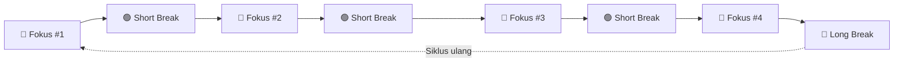
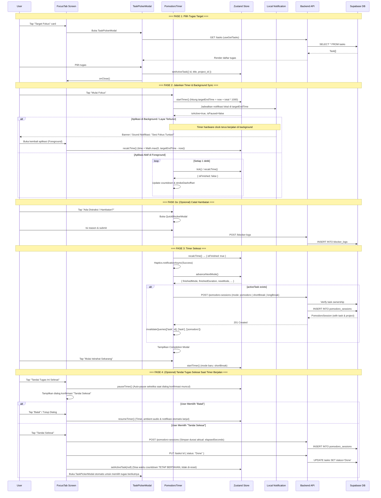

# 🍅 Alur Fitur Pomodoro — StillBuilding

Dokumentasi lengkap alur kerja fitur **Pomodoro Timer** pada aplikasi StillBuilding, mencakup arsitektur backend, frontend, state management, ketahanan timer di mobile background, dan interaksi antar komponen.

---

## 1. Ringkasan Fitur

Fitur Pomodoro pada StillBuilding mengimplementasikan teknik **Pomodoro Technique** dengan siklus 8-step yang terdiri dari **4 sesi fokus** dan **4 sesi istirahat** (3 pendek + 1 panjang).



| Mode         | Label             | Durasi (dev) |  Durasi (prod)   | Warna             |
| :----------- | :---------------- | :----------: | :--------------: | :---------------- |
| `pomodoro`   | Deep Work         |  10 detik\*  | 25 menit (1500s) | `#18181b` (hitam) |
| `shortBreak` | Istirahat Pendek  |  5 detik\*   |  5 menit (300s)  | `#16a34a` (hijau) |
| `longBreak`  | Istirahat Panjang |  10 detik\*  | 15 menit (900s)  | `#2563eb` (biru)  |

> [!NOTE]
> \*Durasi dev dikonfigurasi via `IS_TESTING_MODE` di [`pomodoroPreferences.ts`](apps/mobile/features/pomodoro/types/pomodoroPreferences.ts) untuk mempermudah QA testing. Untuk produksi, nilai diatur ke `false`.

---

## 2. Arsitektur & File Map

### Backend

| File                                                                                                        | Fungsi                                |
| :---------------------------------------------------------------------------------------------------------- | :------------------------------------ |
| [`pomodoro_sessions.routes.ts`](apps/api/src/modules/Pomodoro-sessions/pomodoro_sessions.routes.ts)         | Definisi endpoint REST API            |
| [`pomodoro_sessions.controller.ts`](apps/api/src/modules/Pomodoro-sessions/pomodoro_sessions.controller.ts) | Ekstraksi request & dispatch response |
| [`pomodoro_sessions.service.ts`](apps/api/src/modules/Pomodoro-sessions/pomodoro_sessions.service.ts)       | Business logic & query Supabase       |
| [`pomodoro_sessions.types.ts`](apps/api/src/modules/Pomodoro-sessions/pomodoro_sessions.types.ts)           | Zod schema & TypeScript interface     |

### Frontend

| File                                                                                      | Fungsi                                                              |
| :---------------------------------------------------------------------------------------- | :------------------------------------------------------------------ |
| [`app/(tabs)/focus.tsx`](<apps/mobile/app/(tabs)/focus.tsx>)                              | Screen utama tab Fokus                                              |
| [`PomodoroTimer.tsx`](apps/mobile/features/pomodoro/components/PomodoroTimer.tsx)         | Komponen timer circular + logika visualisasi & kontrol              |
| [`ZenDeskModal.tsx`](apps/mobile/features/pomodoro/components/ZenDeskModal.tsx)           | Modal Zen Desk landscape AMOLED fullscreen dengan keep-awake        |
| [`TaskPickerModal.tsx`](apps/mobile/features/pomodoro/components/TaskPickerModal.tsx)     | Modal bottom sheet pemilih tugas target                             |
| [`QuickBlockerModal.tsx`](apps/mobile/features/pomodoro/components/QuickBlockerModal.tsx) | Modal pencatatan hambatan saat sesi fokus                           |
| [`TaskSelector.tsx`](apps/mobile/features/pomodoro/components/TaskSelector.tsx)           | Dropdown selector proyek                                            |
| [`usePomodoroStore.ts`](apps/mobile/features/pomodoro/store/usePomodoroStore.ts)          | Zustand store (timer state, cycle, wall-clock, multi-task tracking) |
| [`usePomodoro.ts`](apps/mobile/features/pomodoro/hooks/usePomodoro.ts)                    | TanStack Query hooks (CRUD API & invalidation)                      |
| [`pomodoroService.ts`](apps/mobile/features/pomodoro/services/pomodoroService.ts)         | Axios API caller                                                    |
| [`dateHelpers.ts`](apps/mobile/utils/dateHelpers.ts)                                      | Formatter durasi sesi (`formatSessionDuration`: detik/menit)        |
| [`pomodoro.types.ts`](packages/types/src/pomodoro.types.ts)                               | Zod schema & TypeScript interface                                   |

---

## 3. REST API Endpoints

Semua endpoint dilindungi oleh `authMiddleware` (JWT Supabase).

|  Method  | Endpoint                 |        Zod Validation         | Deskripsi                                   |
| :------: | :----------------------- | :---------------------------: | :------------------------------------------ |
|  `GET`   | `/pomodoro-sessions`     |               —               | Ambil semua sesi user (join task → project) |
|  `GET`   | `/pomodoro-sessions/:id` |               —               | Ambil detail satu sesi                      |
|  `POST`  | `/pomodoro-sessions`     | `createPomodoroSessionSchema` | Buat sesi baru (setelah timer selesai 100%) |
|  `PUT`   | `/pomodoro-sessions/:id` | `updatePomodoroSessionSchema` | Update sesi (elapsed, ended_at, completed)  |
| `DELETE` | `/pomodoro-sessions/:id` |               —               | Hapus sesi                                  |

### Payload Create (`POST`)

```json
{
  "task_id": "uuid",
  "mode": "pomodoro",
  "duration": 1500,
  "cycle_index": 0,
  "session_num": 1,
  "started_at": "2026-08-23T03:00:00.000Z",
  "ended_at": "2026-08-23T03:25:00.000Z",
  "completed": true
}
```

### Response Shape

Setiap response menyertakan nested relation `task → project`:

```json
{
  "status": "success",
  "data": {
    "id": "uuid",
    "task_id": "uuid",
    "mode": "pomodoro",
    "duration": 1500,
    "completed": true,
    "cycle_index": 0,
    "session_num": 1,
    "started_at": "...",
    "ended_at": "...",
    "task": {
      "id": "uuid",
      "title": "Setup CI/CD Pipeline",
      "project": {
        "id": "uuid",
        "name": "StillBuilding"
      }
    }
  }
}
```

> [!IMPORTANT]
> **Keamanan**: Endpoint `getAll` dan `getById` menggunakan **inner join** filter `task.project.user_id = userId` sehingga user hanya bisa mengakses sesi miliknya sendiri. Endpoint `create` memverifikasi kepemilikan task melalui `taskService.getById(task_id, userId)` sebelum menyimpan sesi.

---

## 4. State Management (Zustand) & Wall-Clock Engine

Timer state dikelola sepenuhnya di **client-side** menggunakan Zustand store ([`usePomodoroStore.ts`](apps/mobile/features/pomodoro/store/usePomodoroStore.ts)).

### State Shape

```typescript
interface PomodoroState {
  mode: "pomodoro" | "shortBreak" | "longBreak";
  time: number; // detik tersisa (countdown)
  total: number; // total durasi mode saat ini (detik)
  isActive: boolean; // timer sedang berjalan?
  isPaused: boolean; // timer di-pause?
  sessionsCount: number; // jumlah sesi fokus selesai (0–4)
  cycleIndex: number; // posisi dalam CYCLE array (0–7)
  activeTask: ActiveTask | null;
  startedAt: string | null; // ISO timestamp mulai
  targetEndTime: number | null; // Epoch timestamp (ms) target selesai (untuk akurasi background)
  taskInitialRemaining: number | null; // Sisa detik countdown saat tugas mulai difokuskan (mencegah double counting antar-tugas)

  // Actions
  setActiveTask: (task: ActiveTask | null) => void;
  setMode: (mode: PomodoroMode) => void;
  startTimer: () => void;
  pauseTimer: () => void;
  resumeTimer: () => void;
  stopTimer: () => void;
  tick: () => { isFinished: boolean };
  recalcTime: () => { isFinished: boolean }; // Sinkronisasi waktu saat app kembali dari background
  advanceNextMode: () => {
    finishedMode: PomodoroMode;
    finishedDuration: number;
    newMode: PomodoroMode;
    newSessionNum: number;
    newCycleIndex: number;
  };
}
```

### Cycle Array (8-step)

```
Index:  0           1            2           3            4           5            6           7
Mode:   pomodoro    shortBreak   pomodoro    shortBreak   pomodoro    shortBreak   pomodoro    longBreak
```

---

## 5. Alur Lengkap User Flow



---

## 6. Komponen UI Detail & Aturan UX

### 6.1 Focus Tab Screen ([`focus.tsx`](<apps/mobile/app/(tabs)/focus.tsx>))

Screen utama yang meng-_orchestrate_ seluruh fitur Pomodoro:

1. **ScreenHeader** — Judul "Sesi Fokus" + subtitle motivasi.
2. **Target Fokus Card** — Menampilkan tugas aktif atau prompt untuk memilih tugas. Tap untuk membuka `TaskPickerModal`.
3. **PomodoroTimer** — Komponen timer circular utama (lihat 6.2).
4. **Sticky Bottom Button** — Tombol "Tandai Tugas Ini Selesai" (muncul hanya jika ada `activeTask`). Ketika ditekan:
   - **Auto-Pause Seketika**: Timer & audio ambient langsung dijeda seketika begitu pop-up konfirmasi muncul, menjaga sisa waktu tetap akurat saat user membaca konfirmasi.
   - **Batal / Dismiss**: Jika dibatalkan, timer, ambient audio, dan jadwal notifikasi otomatis berlanjut (_resume_).
   - **Simpan Sesi Aktual**: Sesi Pomodoro langsung disimpan ke database dengan durasi kerja riil (`elapsedSeconds = startRemaining - time`).
   - **Sisa Waktu Dipertahankan**: Timer **tidak di-reset**, melainkan tetap berada pada status dijeda dengan sisa waktu yang tersisa.
   - **Pencegahan Double-Counting**: State `taskInitialRemaining` di-set ke sisa waktu saat tugas baru dipilih, sehingga tugas berikutnya hanya dicatat sisa durasinya.
   - **TaskPickerModal Otomatis**: Bottom sheet langsung dibuka otomatis agar user dapat memilih tugas berikutnya dan menekan tombol **"Lanjutkan"**.
5. **TaskPickerModal** — Bottom sheet untuk memilih/mengganti tugas target.

> [!TIP]
> Screen ini menerima parameter `id` via deep link (`/(tabs)/focus?id=<task_id>`), memungkinkan navigasi langsung dari halaman detail tugas ke sesi fokus dengan tugas tersebut sudah terpilih.

### 6.2 PomodoroTimer ([`PomodoroTimer.tsx`](apps/mobile/features/pomodoro/components/PomodoroTimer.tsx))

Komponen inti yang mengelola:

- **Active Mode Pill Badge**: Menampilkan status mode aktif (`Deep Work · Sesi 1/4`, `Istirahat Pendek`, atau `Istirahat Panjang`) dengan dot warna representatif. Tab manual dihilangkan agar alur 8-step Pomodoro berjalan konsisten tanpa manipulasi siklus ad-hoc.
- **Circular Progress Ring**: SVG ring animasi dengan `strokeDashoffset` berdasarkan sisa waktu.
- **Countdown Display**: Teks `MM:SS` dengan persentase & menit tersisa.
- **4-Session Dots**: Indikator visual 4 titik yang terisi sesuai jumlah sesi fokus yang telah selesai dalam siklus berjalan.
- **Control Buttons**:
  - **Mulai / Jeda / Lanjutkan**: Menjalankan atau menjeda timer sesuai mode aktif.
  - **Reset**: Mengatur ulang timer ke durasi awal mode saat ini.
  - **Lewati (_Skip_)**: Memindahkan sesi ke mode berikutnya dalam siklus 8-step secara aman setelah konfirmasi dialog (sesi yang di-skip tidak disimpan ke DB).
- **Blocker Trigger**: Tombol merah yang muncul saat timer aktif untuk membuka `QuickBlockerModal`.
- **Next Mode Indicator**: Label mode berikutnya beserta durasinya.
- **Completion Modal**: Dialog transisi saat sesi selesai untuk melanjutkan ke mode berikutnya (Fokus ➡️ Break atau Break ➡️ Fokus).

### 6.3 QuickBlockerModal ([`QuickBlockerModal.tsx`](apps/mobile/features/pomodoro/components/QuickBlockerModal.tsx))

Bottom sheet yang muncul saat user mengalami hambatan **selama sesi fokus**:

- Otomatis mengaitkan blocker ke `project_id` dari tugas yang sedang difokuskan.
- Jika tidak ada `project_id`, user bisa memilih proyek secara manual.
- Data disimpan ke tabel `blocker_logs` via `POST /blocker-logs`.

### 6.4 TaskPickerModal ([`TaskPickerModal.tsx`](apps/mobile/features/pomodoro/components/TaskPickerModal.tsx))

Bottom sheet pemilih tugas:

- Menampilkan seluruh tugas non-selesai milik user.
- Dikelompokkan per proyek dengan nama proyek sebagai label header.
- User tap tugas → `onSelectTask(task)` → store di-update.

### 6.5 ZenDeskModal ([`ZenDeskModal.tsx`](apps/mobile/features/pomodoro/components/ZenDeskModal.tsx))

Modal mode fokus Zen landscape AMOLED deep black (`#09090b`):

- **Immersive View**: Layar penuh tanpa gangguan status bar maupun navigation bar (didukung di iOS & Android).
- **Keep-Awake**: Layar dijaga tetap menyala via `expo-keep-awake` agar visual timer dapat diletakkan di meja kerja (_desk companion_).
- **Alur Penyelesaian Konsisten**: Dilengkapi tombol "Tandai Selesai" dengan logika auto-pause seketika, konfirmasi aman (resume otomatis saat dibatalkan), dan sisa waktu timer dipertahankan untuk tugas pengganti.

---

## 7. Data Flow & Aturan Penyimpanan Sesi

### 7.1 Kapan Sesi Disimpan ke Database?

Sesi Pomodoro disimpan ke tabel `pomodoro_sessions` pada dua kondisi:

1. **Kondisi A: Timer Selesai Alami 100% (`time === 0`)**
   - Terjadi saat countdown mencapai `00:00` pada mode apapun (`pomodoro`, `shortBreak`, `longBreak`).
   - Jika ada `activeTask`, durasi yang dicatat adalah alokasi kerja untuk tugas tersebut: `finishedDuration = taskInitialRemaining ?? total`.
   - Mode siklus otomatis berpindah via `advanceNextMode()`.

2. **Kondisi B: Tugas Ditandai Selesai Lebih Awal Saat Timer Aktif**
   - User menyelesaikan tugas sebelum countdown habis (`elapsedSeconds > 0` dan `mode === "pomodoro"`).
   - Durasi yang disimpan adalah durasi aktual yang baru saja dikerjakan: `elapsedSeconds = (taskInitialRemaining ?? total) - time`.
   - Timer **tidak di-reset**, melainkan **dijeda (_paused_)** pada sisa waktu yang ada.
   - Sisa waktu interval Pomodoro tersebut dapat dilanjutkan untuk tugas berikutnya tanpa kehilangan waktu fokus.

### 7.2 Perilaku Skenario Khusus

| Skenario                                               | Tindakan Sistem                                                                            | Alasan                                                                          |
| :----------------------------------------------------- | :----------------------------------------------------------------------------------------- | :------------------------------------------------------------------------------ |
| **Sesi Fokus (_Deep Work_) Tuntas**                    | Disimpan ke DB dengan `mode: "pomodoro"`                                                   | Mencatat durasi fokus produktif per tugas/proyek.                               |
| **Sesi Istirahat (_Short / Long Break_)**              | Disimpan ke DB dengan `mode: "shortBreak" / "longBreak"` saat tuntas                       | Mencatat rasio waktu istirahat dan pemulihan energi user.                       |
| **Fokus Tanpa Tugas (_Freeform Focus_)**               | Timer berjalan lokal, **tidak disimpan ke DB**                                             | Menjaga integritas data relasi project & task di Supabase.                      |
| **Reset Manual di Tengah Jalan**                       | Timer di-reset, sesi berjalan **di-discard**                                               | Sesi sengaja dibatalkan / diulang penuh dari awal oleh user.                    |
| **Selesaikan Tugas Lebih Awal**                        | Sesi disimpan dengan durasi aktual (`elapsedSeconds`), task `Done`, timer dijeda (_pause_) | Memberi kredit waktu riil yang telah dikerjakan; sisa waktu dipakai tugas baru. |
| **Multi-Tasking dalam 1 Interval (_Shared Interval_)** | Dilacak via `taskInitialRemaining` di Zustand                                              | Mencegah _double counting_ (misal 25 menit dibagi Task A 10m & Task B 15m).     |

### 7.3 Format Tampilan Durasi Sesi

Untuk memastikan durasi fokus ditampilkan secara akurat di seluruh antarmuka (Card riwayat tugas, Badge statistik, dan Ringkasan proyek):

- Menggunakan helper `formatSessionDuration(seconds)` di [`dateHelpers.ts`](apps/mobile/utils/dateHelpers.ts):
  - **Durasi < 60 detik**: Ditampilkan dalam format detik, contoh: `30d` (memperbaiki bug visual sebelumnya yang keliru menampilkan `30m`).
  - **Durasi > 60 detik (dengan sisa detik)**: Ditampilkan format kombinasi, contoh: `1m 30d`.
  - **Durasi tepat menit**: Ditampilkan format menit, contoh: `25m`.
- Sinkronisasi di backend: Service backend (`pomodoro_sessions.service.ts` dan `stats.service.ts`) menghitung total menit fokus secara presisi dengan pembulatan `Math.round(rawDuration / 60)`.

---

## 8. Database Schema

```sql
CREATE TABLE public.pomodoro_sessions (
  id          uuid        NOT NULL DEFAULT gen_random_uuid(),
  task_id     uuid        REFERENCES public.tasks(id),
  mode        text,                    -- 'pomodoro' | 'shortBreak' | 'longBreak'
  duration    smallint,                -- durasi total dalam detik
  elapsed     smallint,                -- waktu yang telah berlalu (untuk update)
  completed   boolean,                 -- apakah sesi selesai penuh
  cycle_index smallint,                -- posisi dalam siklus (0-7)
  session_num smallint,                -- nomor sesi fokus (1-4)
  started_at  timestamptz,             -- waktu mulai sesi
  ended_at    timestamptz,             -- waktu selesai sesi
  created_at  timestamptz NOT NULL DEFAULT now(),
  CONSTRAINT pomodoro_sessions_pkey PRIMARY KEY (id),
  CONSTRAINT pomodoro_sessions_task_id_fkey FOREIGN KEY (task_id) REFERENCES public.tasks(id) ON DELETE CASCADE
);
```

### Relasi

```
pomodoro_sessions.task_id → tasks.id → tasks.project_id → projects.id → projects.user_id → profiles.id
```

---

## 9. Cache Invalidation

Ketika sesi Pomodoro berhasil disimpan, query cache berikut di-invalidate secara otomatis agar seluruh antarmuka aplikasi tersinkronisasi:

| Query Key          | Alasan Invalidation                                                       |
| :----------------- | :------------------------------------------------------------------------ |
| `['task', taskId]` | Memperbarui statistik total waktu fokus & counter sesi pada detail tugas. |
| `['task']`         | Memperbarui daftar tugas global di Home / Task screen.                    |
| `['pomodoro']`     | Memperbarui riwayat sesi fokus dan grafik produktivitas user.             |

---

## 10. Ketahanan Timer di Mobile (Background & Lock Screen)

Pada lingkungan React Native / Expo, proses `setInterval` akan mengalami throttling atau freeze ketika layar mati atau aplikasi berpindah ke background. Untuk menjamin akurasi 100%:

1. **Wall-Clock Calculation**:
   - Saat timer dimulai, catat `targetEndTime = Date.now() + time * 1000`.
   - Perhitungan sisa waktu selalu menggunakan `Math.max(0, Math.round((targetEndTime - Date.now()) / 1000))`.
2. **AppState Listener**:
   - Tambahkan listener `AppState.addEventListener('change', ...)` pada komponen timer.
   - Saat app kembali berstatus `active` (foreground), panggil `recalcTime()` untuk langsung merefleksikan sisa waktu yang benar.
3. **Local Notification**:
   - Jadwalkan notifikasi lokal instan via `expo-notifications` yang berbunyi/bergetar tepat saat `targetEndTime` tercapai jika user sedang berada di luar aplikasi.
   - Batalkan notifikasi jika user menekan jeda (_pause_) atau reset timer.
